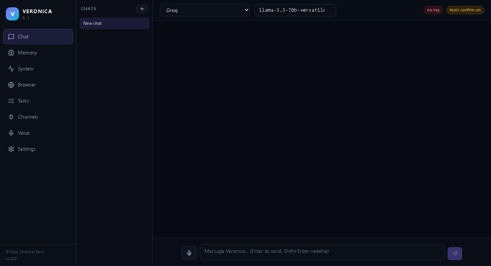
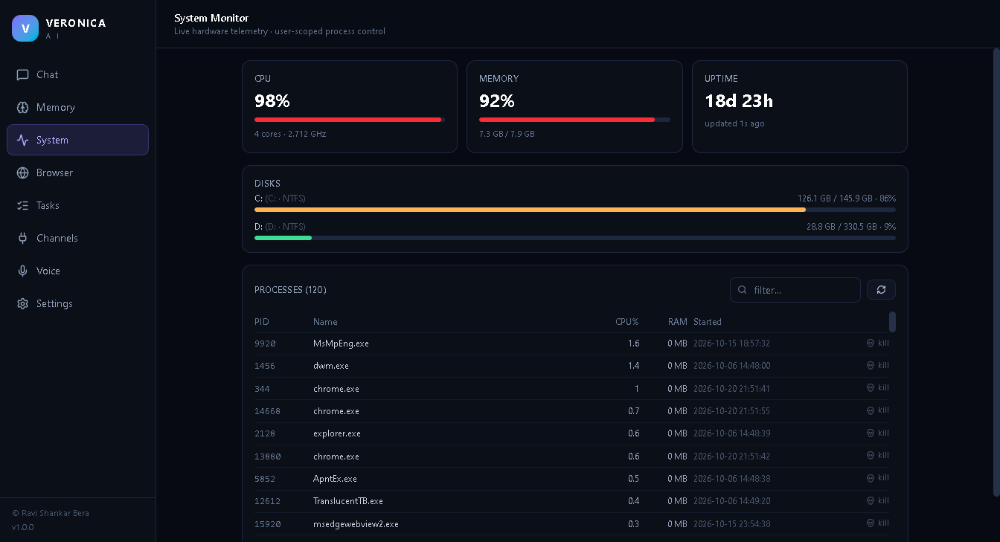
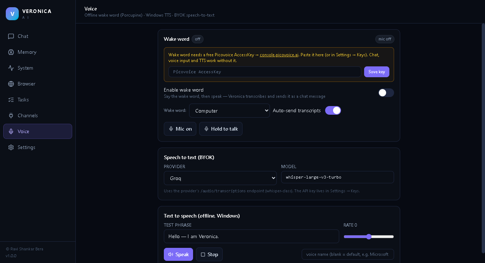
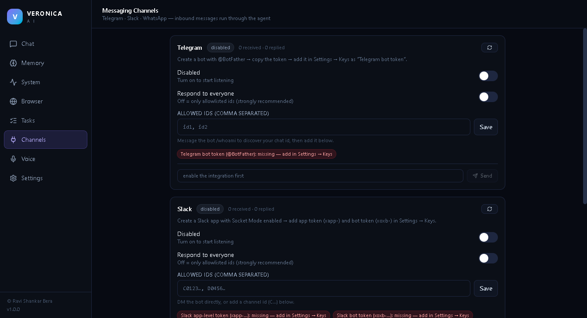

# V.E.R.O.I.C.A — Veronica AI

**A local-first desktop AI companion for Windows.** Chat with any OpenAI-compatible
provider (bring your own key), let an agent harness use real tools on your PC, keep a
private SQLite memory, automate your browser, schedule unattended agentic tasks, get
replies in Telegram / Slack / WhatsApp, and talk to it with an offline wake word.

Original software, written from scratch — **© 2026 Ravi Shankar Bera**, MIT licensed.



## Features

| Area | What it does |
| --- | --- |
| **Chat core + BYOK** | Streaming chat against any OpenAI-compatible endpoint (OpenAI, Groq, OpenRouter, Google Gemini compat, Kimi/Moonshot, DeepSeek, or a custom base URL). API keys are stored **OS-encrypted (Windows DPAPI via Electron `safeStorage`)**, never in settings files. |
| **Harness Agent** | An agentic loop engine with a hard step limit: the model can search/save memory, read system state, kill *user-owned* processes, open/read/act on the browser, create tasks, send channel messages and speak — mutating tools gated behind an interactive confirmation dialog. **Deliberately no arbitrary shell tool.** |
| **Agentic Tasks** | Prompts Veronica runs unattended: once, every N minutes, or on a 5-field cron schedule. Runs are persisted with full logs in SQLite. |
| **Local SQLite memory** | Long-term memory with FTS5 full-text search, auto-capture of chat, and a file-based **kill switch** that hard-blocks all memory writes when present. |
| **System monitor** | Live CPU/RAM/disk gauges and a process list with a guarded kill: system-critical PIDs, Veronica itself, and anything not owned by your Windows account are refused (owner verified via `Win32_Process.GetOwner`, fail-closed). |
| **Browser automation** | Playwright driving your pre-installed **Edge/Chrome** — no browser downloads. Open/read/click/type/screenshot from the UI or from the agent. |
| **Voice + wake word** | Offline Porcupine wake word running in a forked Node child process (**no Python runtime**), 16 kHz mic streaming from the renderer, BYOK speech-to-text (whisper-class), and offline **Windows SAPI** text-to-speech. |
| **Messaging channels** | **Telegram** (Bot API long-polling), **Slack** (Socket Mode), **WhatsApp** (QR pairing via Baileys). Inbound messages run through the agent and reply back — gated by allowlists so it is never an open relay. |





## Quick start

```powershell
# prerequisites: Node.js 22+ (24 recommended), Windows 10/11
cd D:\VERONICA
npm install --legacy-peer-deps
npm run dev        # develop with HMR
npm run build      # typecheck-free production build into out\
npm start          # run the built app
npm run dist       # NSIS installer into dist\ (unsigned)
```

### First-time configuration

1. **Settings → API keys** — paste at least one provider key (Groq has a free tier).
2. **Settings → Chat defaults** — pick provider + model (defaults: Groq / `llama-3.3-70b-versatile`).
3. **Voice** — for the wake word, paste a *free* Picovoice AccessKey from
   [console.picovoice.ai](https://console.porcupine.ai/) (chat / TTS / push-to-talk work without it).
4. **Channels** — add tokens (Telegram bot token, Slack `xapp-`+`xoxb-`), toggle the
   integration on, then message your bot with `/whoami` to discover your id and
   allowlist it. Keep **Respond to everyone** off.

### Where your data lives

Everything is stored under `%APPDATA%\veronica-ai\`:

- `settings.json` — endpoints & preferences (**no secrets**)
- `keys.bin` — DPAPI-encrypted API keys/tokens
- `veronica.db` — sessions, transcripts, memory (FTS5), tasks, run logs (WAL)
- `whatsapp-auth/` — WhatsApp pairing session
- `shots/` — browser screenshots
- `KILL_SWITCH` — create this file to hard-block memory writes (toggle in Memory view)

## Architecture

```
src/
├── shared/types.ts        single IPC contract (methods + events) shared by all layers
├── preload/index.ts       the ONLY bridge: one typed request channel + event subscription
├── main/
│   ├── index.ts           bootstrap: CSP, permission policy, window, services, scheduler
│   ├── security.ts        sender trust gate, navigation locks, permission handler, CSP
│   ├── router.ts          method allowlist dispatch + payload validation
│   ├── confirm.ts         agent confirmation broker (90 s timeout = deny)
│   └── services/
│       ├── settings.ts    typed JSON store (presets for 6 providers)
│       ├── keys.ts        DPAPI-encrypted BYOK key store
│       ├── providers.ts   OpenAI-compatible SSE streaming client
│       ├── memory.ts      better-sqlite3 + FTS5 + kill switch
│       ├── chat.ts        session/transcript persistence + stream control
│       ├── harness.ts     the agent loop (steps, tools, confirmations, abort)
│       ├── agent/tools.ts tool registry (14 tools, confirm gates, no shell)
│       ├── tasks.ts       cron/interval/once scheduler + run logs
│       ├── monitor.ts     systeminformation snapshots + owner-verified kill
│       ├── browser.ts     Playwright (Edge/Chrome channel)
│       ├── integrations/  telegram · slack · whatsapp behind one gated hub
│       └── voice/         Porcupine worker (forked Node) + SAPI TTS + BYOK STT
└── renderer/              React 19 + Tailwind 4 + Zustand, sandboxed, no node access
```

## Security posture

This app was designed *after* a full reverse-engineering review of a comparable
installer, and it deliberately addresses every finding from that review:

- **IPC**: `contextIsolation` on, `sandbox` on, `nodeIntegration` off. Every request
  passes a sender-URL trust gate and an explicit method allowlist; payloads are
  validated. The preload exposes exactly three functions.
- **CSP**: `script-src 'self'`, no inline scripts, no remote origins, `object-src 'none'`.
- **Keys**: DPAPI-encrypted at rest; the renderer only ever sees masked hints.
- **Commands**: there is no general-purpose shell execution tool at all. Process kill
  is owner-verified and fail-closed.
- **Browser**: http(s) only; mutating page actions require confirmation.
- **Channels**: allowlist-gated by default (`/whoami` handshake), never an open relay.
- **Updates**: no auto-updater in v1 — nothing in the app can silently replace itself.
- **Signing**: `npm run dist` produces an **unsigned** installer (no code-signing
  certificate on this machine). For a clean SmartScreen reputation, sign the build
  with a certificate before distributing — that is the one hardening step this repo
  cannot do for you.

## Known limitations / roadmap

- Wake word requires a free Picovoice AccessKey (their licensing, not ours).
- WhatsApp pairing uses the Baileys library (unofficial WhatsApp Web protocol) —
  fine for personal use on your own account, but it is outside WhatsApp's official
  ToS; official Cloud API would require a public webhook URL, which a local-only app
  doesn't have. Use responsibly.
- The app icon is the default Electron icon (custom `.ico` not yet generated).
- No auto-updater and no code signing yet (both intentional for v1).
- Model IDs in provider presets age quickly — edit them in Settings → Providers.

## Third-party stack

Electron · electron-vite · React · Tailwind CSS · Zustand · better-sqlite3 ·
systeminformation · playwright-core · @picovoice/porcupine-node (Apache-2.0) ·
cron-parser · @slack/socket-mode + @slack/web-api · @whiskeysockets/baileys ·
qrcode · lucide-react

## License

MIT — © 2026 **Ravi Shankar Bera**. See [LICENSE](LICENSE).
